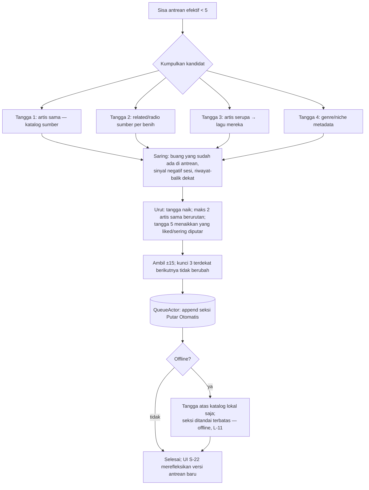
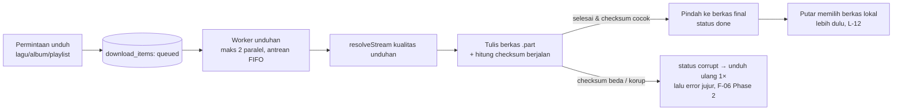

# TECHNICAL BLUEPRINT & ARCHITECTURAL CRITIQUE — Clai

**Fase 3** dari proses resmi (lihat `CARA-KERJA.md`). Induk: `SPESIFIKASI-PRODUK.md` v2.0 (PRD), `USER-FLOW-DAN-LOGIKA.md` v1.0 (Phase 2). Dokumen ini merinci rancangan teknis sampai level yang dapat dieksekusi tanpa keputusan tambahan, dan menutup kritik premis PRD Bab 4.3 dengan vonis berbasis bukti.

**Tanggal:** 23 Oktober 2026 · **Status:** Tertutup — semua keputusan di Bab 9 bersifat final untuk F1; perubahan sesudah ini hanya lewat ADR baru.

---

## 1. Ringkasan Arsitektur Eksekusi

| Lapisan | Teknologi terpilih | Peran |
|---|---|---|
| UI | Flutter 3.47.x (Dart 3), Material 3 dibungkus Clai DS | Presentasi murni; tidak memegang state putar |
| State aplikasi | Riverpod 2.x (provider + StateNotifier) | Injeksi dependensi & state UI; antrean player diekspos sebagai stream |
| Mesin putar | `just_audio` 0.10.x di atas Media3 ExoPlayer + `audio_service` 0.18.x + `audio_session` | Satu `AudioHandler` milik aplikasi; UI tidak pernah menyentuh player langsung (L-01, L-14) |
| Jaringan | `dio` 5.x (interceptor, retry, timeout per kelas permintaan) | Semua panggilan provider lewat satu klien HTTP terkonfigurasi |
| Data lokal | SQLite via `drift` 2.x (typed, migrasi berversi terbukti-kompilasi) | Skema di Bab 2 |
| File lokal | `on_audio_query` (pindai MediaStore) + `audio_metadata_reader` (tag berkas) | Provider File Lokal |
| Berbagi masuk | `receive_sharing_intent` + OCR `google_mlkit_text_recognition` (F2) | Alur F-09 Phase 2 |
| Ekspor/impor | JSON berversi (Bab 7 dokumen ini) via share sheet & file picker | F3; skema ditetapkan sekarang agar F1 tidak melukis jalan buntu |

**Aturan besi lintas lapisan**
1. UI hanya berbicara ke *service* aplikasi (`PlayerService`, `LibraryService`, `ProviderRegistry`), tidak ke plugin langsung — kecuali widget DS murni.
2. Semua mutasi antrean diserialkan oleh satu aktor (`QueueActor`, Bab 4.2) — implementasi harfiah L-08.
3. Provider tidak mengetahui UI dan tidak mengetahui player; ia hanya menjawab kontrak Bab 5.
4. Tidak ada panggilan jaringan dari lapisan UI; semua lewat repository yang menerapkan cache & aturan token (L-13).

---

## 2. Skema Database Fisik (SQLite / drift)

Basis data: satu berkas `clai.db` di direktori dokumen aplikasi. `PRAGMA journal_mode=WAL`, `foreign_keys=ON`. Semua waktu disimpan UTC epoch milidetik (`INTEGER`). ID lagu selalu gabungan `(provider_id, provider_track_id)` — tidak ada ID global tunggal, sesuai PRD Bab 6 ("tidak ada entitas tanpa sumber").

### 2.1 Tabel katalog (cache dari provider)

```sql
CREATE TABLE tracks (
  provider_id        TEXT    NOT NULL,
  provider_track_id TEXT    NOT NULL,
  title              TEXT    NOT NULL,
  artist_names       TEXT    NOT NULL,          -- gabungan tampil, dipisah " • "
  album_id           TEXT,                      -- provider_album_id, nullable (single)
  duration_ms        INTEGER,
  artwork_url        TEXT,
  is_explicit        INTEGER NOT NULL DEFAULT 0,
  playable_ref       TEXT    NOT NULL,          -- ref resolusi aliran per provider (mis. videoId)
  cached_at          INTEGER NOT NULL,
  PRIMARY KEY (provider_id, provider_track_id)
);
CREATE INDEX idx_tracks_title  ON tracks (title);
CREATE INDEX idx_tracks_album  ON tracks (provider_id, album_id);

CREATE TABLE albums (
  provider_id TEXT NOT NULL, provider_album_id TEXT NOT NULL,
  title TEXT NOT NULL, artist_names TEXT NOT NULL,
  year INTEGER, artwork_url TEXT, cached_at INTEGER NOT NULL,
  PRIMARY KEY (provider_id, provider_album_id)
);

CREATE TABLE album_tracks (                     -- urutan album bersifat data, bukan kolom di tracks
  provider_id TEXT NOT NULL, provider_album_id TEXT NOT NULL,
  position INTEGER NOT NULL,
  provider_track_id TEXT NOT NULL,
  PRIMARY KEY (provider_id, provider_album_id, position)
);

CREATE TABLE artists (
  provider_id TEXT NOT NULL, provider_artist_id TEXT NOT NULL,
  name TEXT NOT NULL, artwork_url TEXT, cached_at INTEGER NOT NULL,
  PRIMARY KEY (provider_id, provider_artist_id)
);
CREATE INDEX idx_artists_name ON artists (name);
```

### 2.2 Tabel milik pengguna (sumber kebenaran, tidak pernah ditimpa cache)

```sql
CREATE TABLE liked_tracks (
  provider_id TEXT NOT NULL, provider_track_id TEXT NOT NULL,
  liked_at INTEGER NOT NULL,
  PRIMARY KEY (provider_id, provider_track_id)
);

CREATE TABLE playlists (
  id          TEXT PRIMARY KEY,                 -- UUID lokal untuk playlist pengguna
  name        TEXT NOT NULL,
  description TEXT,
  is_system   INTEGER NOT NULL DEFAULT 0,       -- 1 = Liked (virtual, bukan baris di sini; dicadangkan)
  created_at  INTEGER NOT NULL,
  updated_at  INTEGER NOT NULL
);

CREATE TABLE playlist_entries (
  playlist_id TEXT NOT NULL REFERENCES playlists(id) ON DELETE CASCADE,
  position    INTEGER NOT NULL,
  provider_id TEXT NOT NULL, provider_track_id TEXT NOT NULL,
  added_at    INTEGER NOT NULL,
  PRIMARY KEY (playlist_id, position)
);
CREATE INDEX idx_entries_track ON playlist_entries (provider_id, provider_track_id);
```

Playlist dari *sumber* (mis. playlist YouTube Music) tidak disimpan sebagai `playlists`; ia hidup di cache katalog (`albums`-setara: tabel `remote_playlists` dengan struktur sama seperti `albums` + `remote_playlist_tracks` sejajar `album_tracks`). Pemisahan ini mencegah pembaruan cache menghapus data pengguna — kelas bug yang dilarang PRD Bab 8.

### 2.3 Riwayat, antrean, unduhan, preferensi

```sql
CREATE TABLE playback_events (
  id INTEGER PRIMARY KEY AUTOINCREMENT,
  provider_id TEXT NOT NULL, provider_track_id TEXT NOT NULL,
  started_at INTEGER NOT NULL, listened_ms INTEGER NOT NULL,
  completed INTEGER NOT NULL DEFAULT 0,          -- 1 bila ≥80% (L-07)
  context_kind TEXT, context_id TEXT             -- album/playlist/search/radio/local
);
CREATE INDEX idx_events_time  ON playback_events (started_at);
CREATE INDEX idx_events_track ON playback_events (provider_id, provider_track_id);

CREATE TABLE queue_snapshots (                    -- tepat satu baris, id=1 (L-16)
  id INTEGER PRIMARY KEY CHECK (id = 1),
  context_kind TEXT, context_id TEXT, context_label TEXT,
  seed_json TEXT NOT NULL,                        -- benih sesi (daftar kunci trek + asal)
  manual_json TEXT NOT NULL,                      -- bagian Berikutnya
  continuation_json TEXT NOT NULL,                -- bagian Lanjutan
  autoplay_json TEXT NOT NULL,                    -- bagian Putar Otomatis
  current_ref TEXT,                               -- "section:index" trek berjalan
  position_ms INTEGER NOT NULL DEFAULT 0,
  shuffle_mode TEXT NOT NULL DEFAULT 'off',       -- off | pure | smart (smart = F2)
  repeat_mode TEXT NOT NULL DEFAULT 'off',        -- off | all | one
  autoplay_enabled INTEGER NOT NULL DEFAULT 1,
  session_signals_json TEXT NOT NULL DEFAULT '{}',-- sinyal skip/selesai sesi (L-06/L-07)
  saved_at INTEGER NOT NULL
);

CREATE TABLE download_items (                     -- dipakai F2; skema ditetapkan sekarang
  provider_id TEXT NOT NULL, provider_track_id TEXT NOT NULL,
  status TEXT NOT NULL,                           -- queued|running|paused|done|error|corrupt
  bytes_total INTEGER, bytes_done INTEGER NOT NULL DEFAULT 0,
  local_path TEXT, checksum TEXT, quality TEXT NOT NULL,
  PRIMARY KEY (provider_id, provider_track_id)
);

CREATE TABLE stream_cache (                       -- resolusi URL aliran, berumur pendek
  provider_id TEXT NOT NULL, provider_track_id TEXT NOT NULL,
  resolved_url TEXT NOT NULL, mime TEXT, bitrate INTEGER,
  expires_at INTEGER NOT NULL,
  PRIMARY KEY (provider_id, provider_track_id)
);

CREATE TABLE user_prefs (
  key TEXT PRIMARY KEY, value_json TEXT NOT NULL, schema_v INTEGER NOT NULL
);
```

`user_prefs` memakai skema berversi per kunci grup (playback, appearance, data, driving) agar migrasi preferensi tidak menyentuh data lain.

### 2.4 Retensi & ukuran

| Data | Retensi | Alasan |
|---|---|---|
| Katalog cache (`tracks/albums/artists`) | LRU 90 hari sejak `cached_at`, dibersihkan saat berkas DB > 150 MB | Katalog dapat diambil ulang; data pengguna tidak |
| `playback_events` | Pengaturan pengguna: 30/90/365 hari / selamanya (bawaan 365) | Bahan statistik lokal (PRD 5.10) |
| `stream_cache` | Dibuang saat `expires_at` lewat; maksimal 200 baris | URL aliran berumur ±6 jam (Bab 5.4) |
| `queue_snapshots` | Selalu tepat 1 baris, ditimpa atomik | L-16 |

### 2.5 Migrasi & cadangan (menutup PRD Bab 8)

1. Skema berversi `schemaVersion` drift, dimulai **1**. Setiap kenaikan versi wajib: (a) berkas `migration_v{n}_to_v{n+1}.sql`-setara dalam kode migrasi drift, (b) uji migrasi otomatis dari versi n−1 dan dari versi 1, (c) **cadangan pra-migrasi**: sebelum migrasi jalan, berkas DB disalin ke `clai.db.bak-v{n}`; kegagalan migrasi = aplikasi membuka cadangan dengan data utuh dan menandai insiden di log lokal — tidak ada jalur "DB rusak → mulai dari nol".
2. `liked_tracks`, `playlists`, `playlist_entries`, `playback_events` diklasifikasikan **tidak boleh hilang**: uji migrasi menegaskan jumlah baris keempat tabel ini identik sebelum/sesudah migrasi.

---

## 3. Diagram Alir Data

### 3.1 Pencarian → Putar

```mermaid
sequenceDiagram
    participant U as Pengguna
    participant UI as Layar Cari (S-02/S-03)
    participant R as SearchRepository
    participant P as Provider YTM
    participant Q as QueueActor
    participant A as AudioHandler (just_audio/Media3)
    U->>UI: ketik kueri (debounce 300 ms, token L-13)
    UI->>R: search(kueri, token)
    R->>P: POST youtubei/v1/search (WEB_REMIX)
    P-->>R: renderer mentah
    R->>R: normalisasi → Track/Album/Artist ringkas; upsert katalog cache
    R-->>UI: hasil bertahap per kategori
    U->>UI: ketuk lagu
    UI->>Q: PlayContext(snapshot daftar, index, label) (L-15)
    Q->>Q: tetapkan benih sesi atomik (L-03)
    Q->>P: resolveStream(track) — rantai klien (Bab 5.4)
    P-->>Q: URL aliran + expires_at (tersimpan di stream_cache)
    Q->>A: set ConcatenatingAudioSource dari antrean efektif
    A-->>UI: playing (gerbang tekan→bunyi diukur di sini)
```

### 3.2 Isi Ulang Putar Otomatis (L-05)



### 3.3 Unduhan (F2 — rancangan ditetapkan sekarang, dibangun F2)



### 3.4 Connect (F3 — rancangan saja)

```mermaid
sequenceDiagram
    participant R as Perangkat Remote
    participant H as Perangkat Pemutar (host)
    participant Q as QueueActor host
    R->>H: Penemuan mDNS di LAN + kode pasangan 6 digit
    H-->>R: Token sesi (disimpan kedua sisi, dapat dicabut)
    R->>H: WebSocket lokal (wss, token sesi)
    H-->>R: Snapshot antrean + status (versi antrean)
    R->>H: Operasi (putar/jeda/lompat/mutasi) — masuk antrean operasi serial (L-08)
    H-->>R: Konfirmasi + versi antrean baru; klien berversikan basi melakukan sinkron ulang penuh
    Note over H: Tanpa server pusat; mode relay internet = tambahan F4, bukan syarat
```

---

## 4. Mesin Player — Rancangan Eksekusi

### 4.1 Satu handler, satu player, satu sumber gabungan

- `audio_service` menjalankan satu `ClaiAudioHandler extends BaseAudioHandler`. Di dalamnya **satu** instans `AudioPlayer` (just_audio) yang sumbernya **satu** `ConcatenatingAudioSource` yang isi & urutannya adalah cermin 1:1 dari antrean efektif mesin (Berikutnya + Lanjutan + Putar Otomatis digabung; Sedang Diputar = indeks berjalan).
- Mode pemetaan mode:
  - Shuffle murni = `DefaultShuffleOrder` kustom yang membekukan indeks berjalan (implementasi Fisher–Yates atas salinan, PRD 5.4) — bukan shuffle bawaan yang memindah posisi lagu berjalan.
  - Repeat-Semua diimplementasikan sebagai logika antrean (Lanjutan diulang oleh QueueActor), **bukan** `LoopMode.all` pada sumber gabungan — karena loop sumber tidak tahu batas bagian. Repeat-Satu memakai `LoopMode.one`.
- Crossfade (F2) **tidak** memakai sumber gabungan; lihat ADR-002.
- Jeda fokus, ducking, dan panggilan diatur `audio_session` dengan konfigurasi `AudioSessionConfiguration.music()`; matriks interupsi Phase 2 Bab 2.2 dipetakan 1:1 ke `AudioInterruption` events.

### 4.2 QueueActor (implementasi L-08)

Semua mutasi antrean adalah *command* yang masuk satu antrean FIFO Dart (`StreamQueue`/rantai `Future` terkunci):

`PlayContext, EnqueueNext, EnqueueLater, RemoveAt, MoveItem, ClearSections, AutoplayRefill, SetRepeat, SetShuffle, SetAutoplay, SkipNext/Prev (internal), TrackCompleted (internal), RestoreSnapshot, RemoteOp (F3), VoiceOp (F2)`

- Setiap command menghasilkan **versi antrean baru** (monoton naik) dan snapshot terpublikasi ke UI; UI optimistis hanya untuk geser visual (Phase 2, L-08) dengan nomor versi.
- Setiap command yang mengubah bagian antrean menulis `queue_snapshots` (debounce 300 ms; transisi status putar menulis seketika, L-16).

### 4.3 Pemulihan & pengawasan (implementasi L-10)

- Watchdog posisi: bila status `playing` tetapi posisi tidak maju > 4 detik di luar status buffering yang dilaporkan player → perlakukan sebagai stall: masuk prosedur L-10.
- Penyegaran URL: saat trek mulai diputar, `expires_at` dari `stream_cache` dicatat; trek yang akan diputar dalam 2 posisi ke depan disegarkan proaktif bila tersisa < 30 menit masa berlaku.
- Penghitung kegagalan berurutan disimpan di handler; mencapai 3 → berhenti otomatis + status jujur (persis L-10), penghitung nol lagi pada putar sukses berikutnya.

---

## 5. Kontrak Jaringan — Provider YouTube Music (InnerTube)

### 5.1 Prinsip kontrak

1. Provider mengekspos ke aplikasi hanya kontrak Dart bertipe: `search`, `getAlbum`, `getArtist`, `getPlaylist`, `getRelated` (tangga 2), `getArtistRelated` (tangga 3), `resolveStream`, `getLyrics` (F2). Bentuk JSON InnerTube **tidak pernah** bocor melewati batas provider.
2. Semua permintaan: `POST https://music.youtube.com/youtubei/v1/{search,browse,player,next}` dengan konteks klien di bawah, header `X-YouTube-Client-Name`, `X-YouTube-Client-Version`, `User-Agent` yang konsisten dengan kliennya, dan kunci API publik klien web (kunci yang tertanam di klien resmi; bukan kredensial pengguna — tidak ada akun, tidak ada cookie pengguna).
3. Timeout: koneksi 5 dtk, terima 10 dtk; retry maksimal 2 dengan backoff eksponensial + jitter untuk kesalahan jaringan/5xx; **tidak ada retry** untuk 4xx.

### 5.2 Klien metadata (pencarian & telusur)

| Klien | clientName / versi acuan | Dipakai untuk |
|---|---|---|
| WEB_REMIX | `WEB_REMIX`, versi mengikuti rilis music.youtube.com (±`1.2026xxxx`) | search, browse (album/artis/playlist), next (related), saran pencarian |

Versi klien disimpan sebagai **konstanta yang dapat diperbarui lewat rilis aplikasi** dan ditegaskan uji kontrak (5.6); menanam versi tanpa jalur pembaruan adalah desain naif yang dilarang Bab 0 PRD.

### 5.3 Bentuk data yang dipakai (hasil normalisasi)

Provider menavigasi renderer bersarang dan mengeluarkan bentuk stabil berikut (inilah kontrak yang diuji fixture):

- Search lagu → `musicResponsiveListItemRenderer` pada shelf lagu: `flexColumns` (judul, artis, album), `thumbnail`, `menu` (albumId/artisId), durasi dari kolom ketiga.
- Album/playlist → `musicDetailHeaderRenderer`/`musicResponsiveHeaderRenderer` + daftar `musicResponsiveListItemRenderer` (playlistId `VL…`, album `MPRE…`).
- Related (tangga 2) → endpoint `next` dengan `videoId` benih → `watchNextEndScreenRenderer`/daftar `musicResponsiveListItemRenderer` pada tab "Up next"/stasiun radio (`RDAMVM…`/`RD…` bila tersedia).
- Artis serupa (tangga 3) → browse halaman artis → shelf "Fans also like" (`musicCarouselShelfRenderer` ber-`browseId` artis).

Setiap jalur ekstraksi memiliki **jalur cadangan berbentuk berbeda** (renderer lama/baru) di dalam provider; UI tidak pernah tahu ada dua bentuk.

### 5.4 Resolusi URL aliran — rantai klien (inti ketahanan)

Permintaan `player` dicoba berurutan sampai mendapat `streamingData` dengan format audio yang dapat diputar; urutan ditetapkan dari bukti lapangan proyek sejenis (Bab 6.2):

| Urutan | Klien | Catatan |
|---|---|---|
| 1 | TVHTML5_SIMPLY_EMBEDDED_PLAYER | Sering memberi URL langsung tanpa token; butuh `signatureTimestamp` dari pemutar web |
| 2 | ANDROID_VR (1.65.x) | Tidak menuntut PO token GVS pada praktiknya; bitrate adaptif terbatas |
| 3 | ANDROID (klien aplikasi, versi berjalan) | Cadangan arus utama |
| 4 | IOS (klien aplikasi) | Cadangan kedua |
| 5 | TVHTML5 | Memahami PO token; dipakai tanpa token dulu — gagal = turun rantai |
| 6 | WEB_REMIX | Pilihan terakhir untuk aliran (paling ketat terhadap token) |

Aturan rantai:
- Pilih format: audio-only (`mimeType` berawalan `audio/`), bitrate tertinggi yang ≤ pilihan kualitas pengguna (Rendah ≤ 70 kbps AAC/opus, Normal ≤ 160, Tinggi = tertinggi tersedia); simpan `url`, `mimeType`, `bitrate`, `expires_at = now + expireInSeconds` ke `stream_cache`.
- Kegagalan satu klien (tidak ada `streamingData`, `playabilityStatus` bukan OK, atau 403 saat *probe* HEAD ringan terhadap URL) → klien berikut; kegagalan semua → L-10.
- **PO Token tidak dibuat di F1.** Klien yang menuntutnya dilewati rantai. Pembuatan PO token adalah keputusan arsitektur tersendiri (memerlukan pemutar web tertanam/BotGuard) dan dicatat sebagai pekerjaan F-lanjutan bersyarat, bukan utang diam-diam.
- `signatureTimestamp` & parameter pemutar diambil dari berkas pemutar web music.youtube.com, di-cache 24 jam dengan cadangan terakhir-yang-berhasil.

### 5.5 Perilaku saat sumber berubah (kontrak defensif)

| Perubahan sumber | Deteksi | Perilaku |
|---|---|---|
| Renderer berganti nama/struktur | Uji kontrak ber-fixture gagal di CI; di perangkat: ekstraksi menghasilkan 0 item pada respons non-kosong | Provider menandai dirinya **terdegradasi**: UI menampilkan status "sumber bermasalah" (dibedakan dari gagal jaringan, Phase 2 Bab 5) — tidak pernah daftar kosong palsu |
| Versi klien ditolak (400) | Kode respons `player`/`search` | Naikkan versi klien dari tabel cadangan versi yang disertakan aplikasi (maks 3 versi terakhir yang diketahui) |
| URL aliran 403 di tengah antrean | Probe/putar gagal | L-10: segarkan → lewati + pemberitahuan → 3 berurutan berhenti |
| Bot-gate `LOGIN_REQUIRED` (umum dari IP pusat data) | `playabilityStatus` | Turun rantai klien; bila semua kena, status jujur "sumber menolak dari jaringan ini" — Clai berjalan di IP rumah pengguna sehingga ini kelas tepi, bukan arus utama |
| Katalog wilayah kosong | Respons sah tapi kosong | Status "tidak tersedia di wilayah ini" per konten (F-04 Phase 2) |

### 5.6 Uji kontrak ber-fixture (menutup PRD Bab 8)

- Setiap jalur ekstraksi 5.3 & rantai 5.4 punya fixture JSON terekam (dianonimkan, tanpa data pribadi) di `test/fixtures/innertube/`; uji unit provider memutar fixture dan menegaskan bentuk ternormalisasi — perubahan bentuk sumber menjadi kegagalan uji, bukan kejutan lapangan.
- Satu uji integrasi terjadwal manual (bukan CI publik, untuk menghindari bot-gate IP pusat data) memanggil sumber hidup dan menegaskan rantai resolusi menghasilkan URL yang lolos probe untuk 10 videoId acuan.

---

## 6. Kritik Premis (wajib, berbasis bukti)

### 6.1 Premis A — Flutter + just_audio/audio_service memenuhi gerbang audio

**Yang diklaim PRD 4.3:** Flutter + just_audio (ExoPlayer) + audio_service cukup untuk gapless ≤ 50 ms, crossfade dua-player, dan putar latar yang kebal OEM agresif.

**Bukti:**
1. *Gapless.* Dokumentasi resmi just_audio: "Playback between items will be gapless on Android" untuk `ConcatenatingAudioSource`; matriks fiturnya menandai gapless ✅ di Android. Di bawahnya Media3 ExoPlayer memang dirancang untuk transisi tanpa celah antar item dalam satu `ConcatenatingMediaSource`. Gerbang ≤ 50 ms dapat dicapai **dengan syarat** item berikut sudah ter-buffer (lazy preparation aktif) dan format antar item konsisten (AAC/opus dari sumber yang sama). Untuk berkas lokal dengan encoder-delay tak diketahui, celah presisi tidak dapat dijanjikan — PRD mengukur pada kumpulan uji sumber, dan di sanalah janji itu berlaku.
2. *Crossfade.* just_audio **tidak memiliki crossfade bawaan**; mengelola dua `AudioPlayer` secara manual adalah satu-satunya jalan di ekosistem ini, dan itu bertabrakan dengan model sumber-gabungan tunggal untuk gapless (dua mode tidak dapat aktif bersamaan pada satu handler tanpa mengganti arsitektur sumber di tengah antrean). PRD menaruh crossfade di F2 dan gapless juga di F2 dengan gerbang yang sama — tanpa keputusan eksklusivitas, keduanya tidak dapat lulus bersamaan. **Premis "crossfade melalui pengelolaan dua player" benar sebagai teknik, naif sebagai janji simultan.**
3. *Latar & OEM.* Dokumentasi audio_service sendiri mengakui pengecualian proses oleh pengoptimal baterai dan meresepkan jalur permintaan pengecualian; FAQ plugin latar generik menyebut MIUI secara eksplisit ("Some android device manufacturers have a custom android os for example MIUI"); laporan lapangan OEM (Xiaomi/HyperOS mereset izin autostart seusai OTA, dsb.) menunjukkan **tidak ada kerangka** — termasuk Kotlin native murni — yang kebal: yang membunuh adalah kebijakan OEM terhadap proses, bukan bahasa UI. Android 14+ menambah syarat formal: izin `FOREGROUND_SERVICE_MEDIA_PLAYBACK` + `android:foregroundServiceType="mediaPlayback"`, dan `POST_NOTIFICATIONS`.

**Vonis: PERTAHANKAN, dengan dua koreksi mengikat (ADR-001 & ADR-002).** Mengganti Flutter dengan native tidak membeli ketahanan OEM apa pun dan membuang keunggulan yang sudah terverifikasi (spring 60 fps, satu basis kode). Yang dibeli paket mitigasi di ADR-001 — dan kejujuran mode di ADR-002.

**ADR-001 — Paket ketahanan latar (mengikat F1):**
1. Manifest: `FOREGROUND_SERVICE_MEDIA_PLAYBACK`, `POST_NOTIFICATIONS`, `WAKE_LOCK`, `REQUEST_IGNORE_BATTERY_OPTIMIZATIONS`; layanan audio_service bertipe `mediaPlayback`.
2. `androidStopForegroundOnPause: false` — layanan tetap foreground saat jeda agar memulai lagi tidak memerlukan startForeground dari latar (penyebab klasik `ForegroundServiceDidNotStartInTimeException` di perangkat agresif).
3. Panduan izin di dalam aplikasi (PRD Bab 10) bersifat *detektif*: aplikasi memeriksa status pengecualian baterai & autostart OEM yang terdeteksi (Xiaomi/Samsung/Oppo/Vivo/Huawei) dan menawarkan langkah persis per merek — bukan teks generik.
4. Gerbang Bab 3 untuk latar diukur **pada perangkat uji MIUI pemilik**; lulus/tidak dicatat per merek di catatan rilis.

**ADR-002 — Eksklusivitas mode transisi (mengikat F2):** Gapless (sumber gabungan) dan Crossfade (dua player) adalah **mode yang saling eksklusif**, dipilih pengguna di Pengaturan → Perilaku Putar (bawaan: Gapless). Beralih mode membangun ulang sumber audio pada batas lagu, tidak pernah di tengah lagu. Klaim gerbang Bab 3 berlaku per mode aktif, dan UI menyatakan mode aktif dengan jujur. PRD Bab 5.4 diperbarui menunjuk ADR ini pada revisi berikutnya.

### 6.2 Premis B — InnerTube sebagai satu-satunya sumber awal

**Yang diklaim PRD 4.1:** satu sumber (YouTube Music via InnerTube) untuk metadata + audio menghindari bug salah-cocok dua sumber.

**Bukti:**
1. Klaim anti-salah-cocok **terbukti benar secara konstruksi**: metadata & aliran berasal dari videoId yang sama; kelas bug Spotube (mencocokkan trek Spotify ke video YouTube yang salah) tidak dapat terjadi.
2. Tetapi ketergantungannya rapuh bila diperlakukan polos: (a) klien WEB/WEB_REMIX semakin dituntut **PO Token** untuk aliran (sistem token terdokumentasi luas di ekosistem yt-dlp, dengan kebijakan per-klien); (b) permintaan dari IP pusat data kerap kena `LOGIN_REQUIRED` bot-gate; (c) bentuk renderer berubah tanpa pemberitahuan (seluruh riwayat proyek sejenis).
3. Praktik lapangan proyek sejenis yang bertahan (InnerTune & kerabatnya, pemutar pihak ketiga lain) **tidak** memakai satu klien: metadata dari WEB_REMIX, resolusi aliran dari **rantai klien** (TVHTML5_SIMPLY_EMBEDDED → ANDROID_VR → ANDROID → IOS → TVHTML5 → WEB) — pola yang sama ditemukan terdokumentasi pada provider pihak ketiga lain dengan urutan serupa.

**Vonis: PERTAHANKAN satu sumber, TOLAK satu klien.** Arsitektur Bab 5 dokumen ini (kontrak defensif + rantai resolusi 6 klien + fixture + status terdegradasi) adalah bentuk tidak-naif dari premis ini. Lapisan provider PRD 4.2 tetap menjadi jalan keluar struktural: bila YouTube menutup semua klien tanpa token, provider kedua dapat ditambah tanpa menyentuh player — persis mitigasi PRD Bab 10, kini dengan mekanisme deteksinya (5.5).

---

## 7. Format Ekspor/Impor JSON (F3 — skema ditetapkan sekarang)

```json
{
  "format": "clai-export",
  "version": 1,
  "exportedAt": "2026-10-23T00:00:00Z",
  "appVersion": "1.0.0",
  "liked": [
    {"providerId": "ytmusic", "trackId": "VIDEO_ID", "title": "…", "artistNames": "…"}
  ],
  "playlists": [
    {"name": "…", "description": null,
     "tracks": [{"providerId": "ytmusic", "trackId": "…", "title": "…", "artistNames": "…"}]}
  ],
  "includeHistory": false,
  "history": []
}
```

Aturan: `version` adalah versi *format* (bukan aplikasi); pengimpor menolak versi lebih baru dengan penjelasan (F-12 Phase 2); judul/artis disertakan agar trek yang tidak lagi ditemukan di sumber tetap dapat dicari ulang secara eksplisit oleh pengguna, bukan hilang; impor bersifat atomik dan selalu didahului ringkasan perubahan (tambah/gabung/ganti).

---

## 8. Tinjauan Bottleneck, Keamanan, Biaya

### 8.1 Bottleneck yang dirancang keluar

| Titik sempit | Rancangan |
|---|---|
| Resolusi aliran per lagu (panggilan `player` lambat) | Pra-resolusi 2 trek ke depan + `stream_cache`; putar tidak menunggu resolusi trek berjalan dari nol |
| Isi ulang otomatis memperebutkan jaringan dengan buffer audio | Prioritas lalu lintas di klien HTTP: buffer aliran > resolusi > metadata > related; isi ulang ditunda saat buffering aktif |
| Daftar 1.000+ item pada perangkat kelas bawah | Daftar virtual (builder), sampul di-decode pada ukuran tampil, cache gambar terukur (maks 150 MB) |
| Antrean sangat panjang (356+ trek) dalam satu sumber gabungan | Batas jendela sumber gabungan: materi di sekitar indeks berjalan (±60 trek) yang dipetakan QueueActor dari antrean logis penuh — mencegah beban memori ExoPlayer; pemetaan ini transparan bagi logika L-01…L-16 |
| Pindai file lokal (ribuan berkas) | Lewat MediaStore (sudah terindeks sistem), bukan rekursi berkas; hasil bertahap |

### 8.2 Keamanan & privasi

- Tidak ada server, tidak ada akun, tidak ada telemetri, tidak ada SDK analitik/iklan — permukaan serangan jaringan aplikasi hanya dua: API InnerTube & CDN gambar/aliran googlevideo, keduanya HTTPS.
- Data pengguna hidup di direktori privat aplikasi; ekspor hanya atas aksi pengguna eksplisit lewat share sheet sistem. Berkas cadangan pra-migrasi berada di direktori privat yang sama.
- URL aliran di `stream_cache` berisi token berumur pendek dari sumber; ia tidak ditulis ke log dan tidak masuk ekspor.
- Izin yang diminta F1 dan alasannya (dinyatakan di aplikasi): Internet (inti), notifikasi (kontrol putar), layanan latar media (putar latar), abaikan optimasi baterai (ketahanan latar), audio media (file lokal, diminta saat fitur dibuka — bukan saat instal).

### 8.3 Biaya infrastruktur

**Rp0, secara konstruksi.** Tidak ada server, basis data awan, kunci API berbayar, atau analitik. Satu-satunya "infrastruktur" adalah perangkat pengguna dan API publik sumber. Konsekuensi jujurnya: ketersediaan katalog sepenuhnya bergantung pada sumber (dimitigasi Bab 5.5 & 6.2), dan tidak ada kanal pemulihan jarak jauh — pembaruan aplikasi adalah satu-satunya kanal perbaikan, sehingga gerbang uji kontrak (5.6) adalah pengganti infrastrukturnya.

---

## 9. Tabel Keputusan (penutup Fase 3)

| # | Keputusan | Status |
|---|---|---|
| D-01 | SQLite via drift; skema Bab 2; migrasi + cadangan pra-migrasi wajib | Final F1 |
| D-02 | Satu AudioHandler, satu player, satu ConcatenatingAudioSource; jendela materi ±60 | Final F1 |
| D-03 | QueueActor serial untuk semua mutasi antrean (L-08) | Final F1 |
| D-04 | Provider YTM: metadata WEB_REMIX; resolusi aliran rantai 6 klien; tanpa PO token di F1 | Final F1 |
| D-05 | ADR-001 paket ketahanan latar (manifest, stopForegroundOnPause=false, panduan OEM detektif) | Final F1 |
| D-06 | ADR-002 gapless XOR crossfade (F2), bawaan gapless | Final F2 |
| D-07 | Format ekspor `clai-export` v1 (Bab 7) | Final F3 |
| D-08 | Biaya infrastruktur Rp0; tanpa server; tanpa telemetri | Final |

**Fase 3 dinyatakan tertutup** dengan dokumen ini. Yang tersisa untuk fase berikut, ditugaskan eksplisit: rupa visual status terdegradasi & panduan OEM → Phase 4; pemecahan menjadi tugas atomik → Phase 5; pembuatan PO token → keputusan bersyarat pasca-F1 bila rantai klien terbukti tidak cukup di lapangan.
